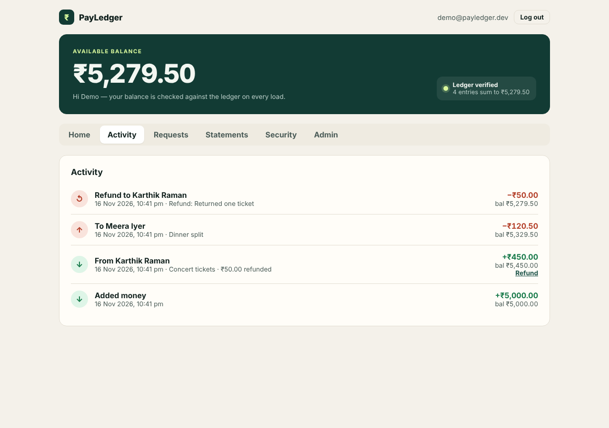
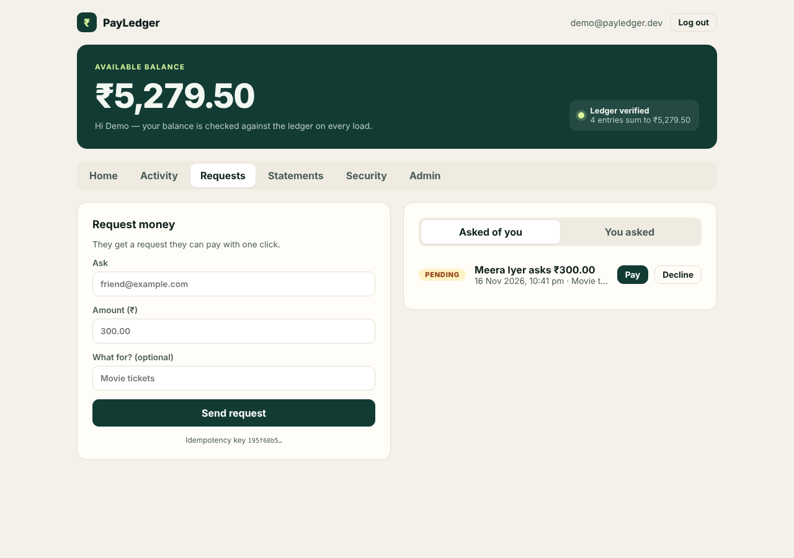
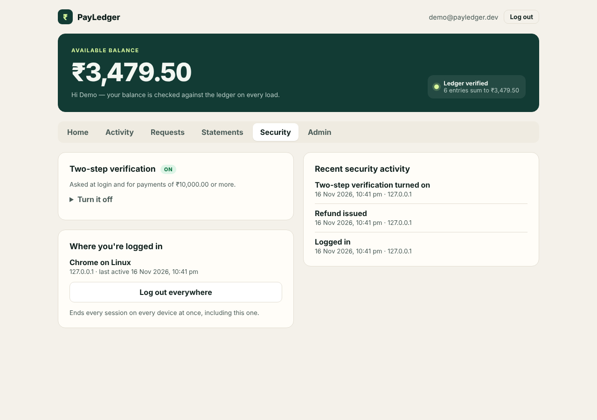
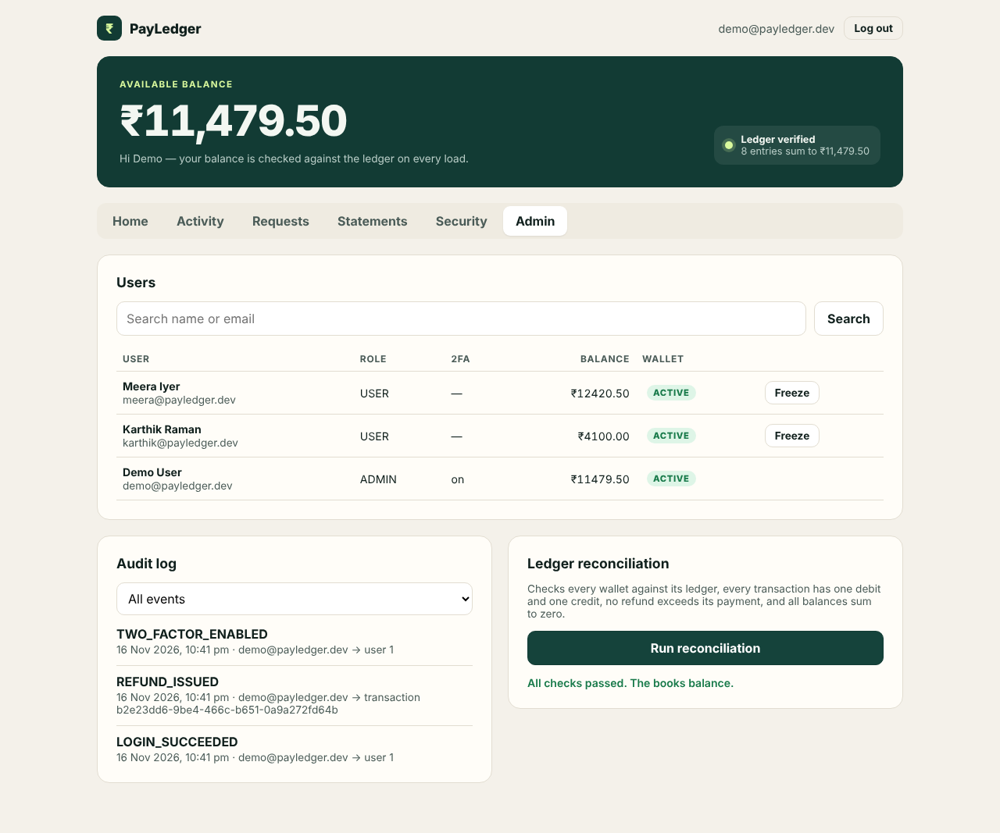
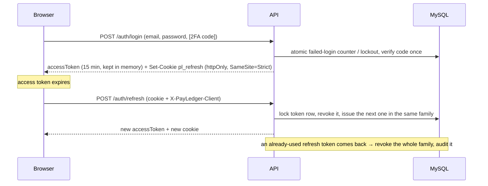
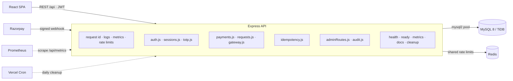

# PayLedger

**A digital wallet and payments platform built like a fintech backend: money stays correct under concurrent requests, retries, webhooks and attacks.**

Users add money (simulated, or real Razorpay test payments), send it, request it, refund it and download statements.
Underneath, every payment is a double-entry ledger write, rows are locked in a fixed order, every payment is
idempotent, sessions rotate, large payments need two-step verification, and every security event is audited.


**Live demo:** [digital-wallet-coral-theta.vercel.app](https://digital-wallet-coral-theta.vercel.app) — log in with `demo@payledger.dev` / `demo12345`
· **API docs:** `/api/docs`


| 105 automated tests | 0 double-spends | 0 deadlocks | ~320 transfers/s |
|:---:|:---:|:---:|:---:|
| against real MySQL in CI | 50 simultaneous transfers | with ordered locking | ledger still balanced |

---

## What's inside

| Area | What it does |
|---|---|
| **Payments** | Top-ups, transfers by email, **refunds** (full or partial), **payment requests** (pay / decline / cancel), daily and per-payment limits |
| **Correctness** | Double-entry ledger, integer paise, `SELECT … FOR UPDATE` in a fixed lock order, idempotency keys, DB `CHECK` constraints, full-ledger reconciliation |
| **Payment gateway** | **Razorpay** orders + Checkout + **signed webhooks**; whichever confirmation arrives first credits the wallet, exactly once |
| **Sessions** | 15-minute JWT access token in memory + **rotating refresh token** in an httpOnly cookie, stored hashed, with **theft detection**; log out everywhere |
| **Account security** | **TOTP two-step verification** (RFC 6238, written with `node:crypto`), **step-up codes** for transfers ≥ ₹10,000, account **lockout**, per-IP and per-user **rate limits** (Redis-backed) |
| **Back office** | **Admin role**: search users, **freeze / unfreeze** wallets, **audit log** viewer, on-demand reconciliation |
| **Statements** | CSV and PDF for any date range, with opening / closing balances and CSV-injection protection |
| **Operations** | JSON logs with **request ids**, **Prometheus metrics**, liveness / readiness probes, **versioned migrations**, daily cleanup cron, **graceful shutdown**, **OpenAPI 3.1 + Swagger UI** |

| Activity with refunds | Payment requests |
|---|---|
|  |  |
| **Security: 2FA, devices, security events** | **Admin: users, freeze, audit log, reconciliation** |
|  |  |

---

## The core problem, in one experiment

A wallet holds ₹100. Fifty requests to send ₹10 arrive at the same moment. Exactly 10 should succeed.

`npm run race-demo` runs this against MySQL 8 (it runs in CI too):

| Method | Transfers accepted (correct: 10) | Money created from nothing |
|---|:---:|:---:|
| Read balance, check, write (no lock) | **50** | **₹440** |
| `SELECT … FOR UPDATE` (this project) | **10** | **₹0** |

| Method (100 transfers, half A→B, half B→A) | Deadlocks |
|---|:---:|
| Lock the sender's wallet first | 50 |
| Lock the lower wallet id first (this project) | **0** |

---

## How money stays correct

| Risk | What could go wrong | How PayLedger prevents it |
|---|---|---|
| **Double-spending** | Two ₹60 transfers from a ₹100 wallet both succeed | `SELECT … FOR UPDATE` on the wallet; the balance check runs only after the lock |
| **Deadlocks** | A→B and B→A each wait for the other | Wallets always locked in ascending id order; every path locks *business row → wallets*; rare deadlocks retried |
| **Duplicate payments** | A retry after a lost response pays twice | `Idempotency-Key` + UNIQUE index, inserted in the **same transaction** as the payment |
| **Over-refunding** | Two refunds at once return more than was paid | The original payment row is locked first; refunds of one payment run one at a time |
| **Double gateway credit** | Browser confirmation and webhook both credit | Order row locked and marked PAID in the crediting transaction; `external_ref` UNIQUE |
| **Lost money** | One balance updated, the other not | Double-entry: one DEBIT + one CREDIT per transaction; `reconcile` proves it |
| **Rounding errors** | `0.1 + 0.2 = 0.30000000000000004` | Integer paise (`BIGINT`), parsed from strings |
| **Future bugs** | New code overdraws a wallet | `CHECK (balance_paise >= 0)` at the database |

### One transfer, step by step (a single DB transaction)

```
BEGIN
  INSERT idempotency key                 -- already used? replay the saved response and stop
  [₹10,000+]  verify 2FA code, mark its time step used (conditional UPDATE: single use)
  find recipient by email
  SELECT wallet (lower id)  FOR UPDATE
  SELECT wallet (higher id) FOR UPDATE
  check frozen status, currency, balance, per-transfer and daily limits   -- on the locked rows
  UPDATE sender   balance - amount
  UPDATE receiver balance + amount
  INSERT transaction + 2 ledger entries (DEBIT, CREDIT)
  save the response on the idempotency key
COMMIT
```

---

## Security



- **Refresh tokens** are random 256-bit values; only their SHA-256 hash is stored. Each works once (rotation).
  Reuse of a rotated token means it was copied, so the whole session family is revoked.
- **Log out everywhere** revokes every refresh token and bumps `token_version`, so even unexpired access tokens stop working at once.
- **Lockout:** 5 failures lock an account for 15 minutes, counted with one atomic `UPDATE` (12 simultaneous guesses cannot slip through; tested).
- **2FA (TOTP):** checked against the RFC 6238 test vectors; a code can be used once; required at login and for transfers ≥ ₹10,000.
- **Rate limits:** 10 logins / 15 min per IP, 300 requests / min per IP, 30 payments / min per user; shared via Redis.
- **Also:** bcrypt, same response and timing for unknown emails, parameterised SQL, Zod validation, UUIDs instead of
  internal ids, CSRF header on cookie endpoints, CSP and HSTS headers, secrets redacted from logs, webhook signatures
  compared in constant time.

---

## Architecture



```
users ──1:1── wallets ──1:N── ledger_entries ──N:1── transactions ──0:N── transactions (refunds)
  ├──1:N── idempotency_keys        ├──1:N── refresh_tokens        ├──1:N── gateway_orders
  ├──1:N── payment_requests (as requester or payer)               └──1:N── audit_logs
```

Schema: [`server/db/migrations/`](server/db/migrations/) (numbered, recorded in `schema_migrations`, safe to re-run).

### Where to look in the code

| File | Why it matters |
|---|---|
| [`server/src/payments.js`](server/src/payments.js) | Lock ordering, checks on locked rows, double-entry posting, refunds, reconciliation |
| [`server/src/idempotency.js`](server/src/idempotency.js) | Run-at-most-once: unique-index insert, replay, request hashing, crash safety |
| [`server/src/sessions.js`](server/src/sessions.js) | Refresh-token rotation, theft detection, log out everywhere |
| [`server/src/auth.js`](server/src/auth.js) · [`totp.js`](server/src/totp.js) | Lockout, 2FA, login flow; TOTP from scratch |
| [`server/src/gateway.js`](server/src/gateway.js) | Razorpay orders, signature checks, exactly-once crediting |
| [`server/scripts/migrate.js`](server/scripts/migrate.js) | Versioned, re-runnable migrations |
| [`server/tests/`](server/tests/) | 105 tests against real MySQL, including the race conditions |
| [`docs/DESIGN.md`](docs/DESIGN.md) | Every design decision and trade-off in plain English |

---

## Design decisions and trade-offs

| Decision | Why | Trade-off |
|---|---|---|
| `SELECT … FOR UPDATE` instead of one conditional `UPDATE` | A transfer runs several checks and records balance-after in the ledger, so it needs a stable row for the whole transaction | Holds the lock slightly longer |
| Idempotency key inserted in the **same transaction** as the payment | A crash rolls both back; no "stuck" key to clean up | Concurrent duplicates wait on the unique index |
| Failed payment results are saved and replayed too | A retry must never become a *new* payment | A genuine new attempt needs a new key |
| 2FA code **excluded** from the idempotency hash | A retry with a newer code is the same payment | — |
| Access token in memory, refresh token in httpOnly cookie | XSS cannot read the long-lived credential | A page reload needs one `/auth/refresh` call |
| 30-second grace for a just-rotated refresh token | Two tabs refreshing together don't log the user out | A replay inside 30 s is rejected but not treated as theft |
| Gateway order created **outside** a DB transaction | Never hold row locks while waiting on the network | Unpaid orders are left behind (they expire at Razorpay) |
| Rate limiter fails **open** when Redis is down | A limiter outage must not become a payments outage | Briefly no shared limits during a Redis outage |
| Additive-only migrations | Old code keeps running against the new schema during a deploy | Removing a column takes two deploys |
| A single SYSTEM wallet funds all top-ups | Keeps the ledger closed: all balances sum to 0 | Hot row: top-ups run one at a time |

More known limits (no 2FA recovery codes, lockout can be used to annoy, no FX) are listed in
[`docs/DESIGN.md`](docs/DESIGN.md#18-trade-offs-and-limits-be-honest-about-these).

---

## API

Full reference: **Swagger UI at `/api/docs`**, spec at [`server/openapi.yaml`](server/openapi.yaml) (a test fails if a route is undocumented).

| Method | Endpoint | Purpose |
|---|---|---|
| POST | `/api/auth/register` · `/login` · `/refresh` · `/logout` · `/logout-all` | Sessions |
| GET | `/api/auth/sessions` | Logged-in devices |
| POST | `/api/auth/2fa/setup` · `/enable` · `/disable` | Two-step verification |
| GET | `/api/me` · `/api/me/security-events` | Profile, limits, enabled features; own security events |
| POST | `/api/wallet/topups` | Simulated top-up |
| POST | `/api/wallet/topups/orders` · `/orders/:id/confirm` | Razorpay top-up |
| POST | `/api/transfers` | Send money (`otp` for ₹10,000+) |
| POST | `/api/transactions/:id/refunds` | Refund a received transfer |
| GET/POST | `/api/payment-requests` · `/:id/pay` · `/:id/decline` · `/:id/cancel` | Request money |
| GET | `/api/wallet/activity` · `/verify` · `/statement?from&to&format=csv\|pdf\|json` | History, ledger check, statements |
| GET/POST | `/api/admin/users` · `/users/:id/freeze` · `/unfreeze` · `/audit-logs` · `/reconcile` | Back office (ADMIN) |
| GET | `/api/health` · `/api/ready` · `/api/metrics` | Probes and Prometheus |
| POST | `/api/webhooks/razorpay` | Signed gateway webhook |

Money-moving requests need an `Idempotency-Key` header. Errors always look like `{"error": {"code", "message"}}`;
500s also include a `requestId` you can find in the logs.

```bash
curl -X POST localhost:4000/api/transfers \
  -H "Authorization: Bearer $TOKEN" \
  -H "Idempotency-Key: 3f1c9a7e-pay-rent" \
  -H "Content-Type: application/json" \
  -d '{"toEmail":"meera@payledger.dev","amount":"120.50","note":"Dinner split"}'
```

---

## Testing

Tests run against a **real MySQL**, because locking cannot be tested with mocks.

| Suite | Tests | Highlights |
|---|:---:|---|
| `api.test.js` | 22 | Auth, payments, idempotency (20 simultaneous duplicates → 1 transfer), 50 simultaneous transfers → exactly 10, history |
| `money.test.js` | 21 | Parsing rupees to paise, formatting, India-time day boundary |
| `security.test.js` | 19 | Refresh rotation, two-tab race, **stolen token revokes the session**, log out everywhere, lockout under 12 concurrent guesses, 2FA, single-use codes, step-up |
| `money-features.test.js` | 18 | **10 simultaneous refunds → exactly 5**, pay vs cancel race → exactly one wins, statements, CSV injection, frozen wallets |
| `admin-gateway-ops.test.js` | 20 | Freeze/audit, **webhook + browser confirm at once → one credit**, forged signatures, metrics, readiness, cleanup, OpenAPI covers every route |
| `totp.test.js` | 5 | RFC 6238 test vectors, clock-drift window |

```bash
npm test             # all 105
npm run race-demo    # the experiment above
npm run benchmark    # load test (wipes its database: use a scratch DB)
npm run reconcile    # audits the whole ledger; exits 1 on any mismatch
```

**CI** (GitHub Actions, every push and pull request): tests on MySQL 8.4, migrations run twice, the race demo,
a readiness check with Redis, and the frontend build.

### Load test

2,000 random transfers between 50 users, 50 concurrent clients, one Node process + MySQL on a 2-core dev container.

| Throughput | p50 | p95 | p99 | Errors | Ledger balanced after |
|:---:|:---:|:---:|:---:|:---:|:---:|
| ~320 transfers/s | ~146 ms | ~203 ms | ~227 ms | 0 | yes |

---

## Run it locally

Needs Node 20+ and MySQL 8. Redis is optional.

```bash
cp .env.example .env              # set DATABASE_URL and JWT_SECRET
npm install && npm --prefix web install
npm run migrate                   # apply migrations
npm run seed                      # demo data
npm run dev                       # API on http://localhost:4000
npm run web:dev                   # React app on http://localhost:5173
```

Or everything (MySQL, Redis, app) with Docker: `docker compose up --build`, then open http://localhost:4000.

Make yourself an admin: `npm run make-admin -- you@example.com`. Daily housekeeping: `npm run cleanup`.

**Razorpay (optional, test mode):** create test API keys and a webhook (`payment.captured`, pointing to
`/api/webhooks/razorpay`) in the Razorpay dashboard, then set `RAZORPAY_KEY_ID`, `RAZORPAY_KEY_SECRET` and
`RAZORPAY_WEBHOOK_SECRET`. A "Pay with Razorpay" card appears; test cards and UPI work without real money.

## Deployment

The live demo runs on **Vercel** (Singapore) with a **TiDB Cloud** database (MySQL-compatible). `/api/*` runs as a
serverless function; the build applies migrations and seeds the demo data. A daily Vercel Cron runs the cleanup.

| Variable | Needed | Value |
|---|---|---|
| `DATABASE_URL`, `JWT_SECRET`, `DB_SSL=true` | yes | database and signing secret |
| `CRON_SECRET` | yes | protects the daily cleanup |
| `METRICS_TOKEN` | for metrics | protects `/api/metrics` |
| `REDIS_URL` | recommended | shared rate limits (e.g. Upstash) |
| `RAZORPAY_*` | optional | real test-mode payments |
| `ADMIN_EMAIL` | optional | promote your own account to admin (never the public demo account) |

All variables are listed in [`.env.example`](.env.example).

## Project layout

```
api/index.js            Vercel entry → Express app
server/src/             app, auth, sessions, totp, twoFactor, payments, idempotency, requests, gateway,
                        statements, adminRoutes, opsRoutes, audit, metrics, logger, rateLimits, maintenance
server/db/migrations/   numbered schema migrations
server/scripts/         migrate, seed, reconcile, race-demo, benchmark, cleanup, make-admin
server/tests/           Vitest + Supertest against real MySQL
server/openapi.yaml     API specification
web/src/                React app (tabs: home, activity, requests, statements, security, admin)
docs/                   DESIGN.md, screenshots
```

## Next steps

- 2FA recovery codes, and WebAuthn passkeys
- Refunds back to the card through the gateway
- An outbox table + worker for notifications (email/SMS on large payments)
- Sharded funding wallets to remove the SYSTEM-wallet hot row
- OpenTelemetry tracing across the API and database

---

Built by [Asmitha A G](https://github.com/assmitha2004) · [LinkedIn](https://linkedin.com/in/asmitha-a-g)
